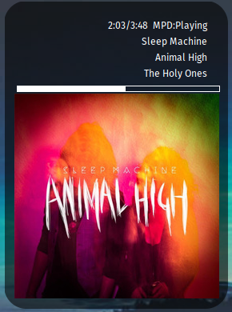

# vindauga

Export the current album cover for `conky` or other desktop widgets. The script
is intentionally small: it checks the active player, finds nearby cover art,
rounds the corners, and writes the result to a cache file.


## Contents

1. [About](#1-about)
2. [License](#2-license)
3. [Prerequisites](#3-prerequisites)
4. [How to use](#4-how-to-use)

***

## 1. About

`vindauga` looks up the currently playing track from `audacious` first and falls
back to `mpd` if `audacious` is not actively playing. It then checks the song's
directory for `folder.jpg` or `cover.jpg`. If neither exists, it falls back to
the bundled default image.

The script does not open a display window and it does not run as its own loop.
It runs once, updates the cached output, and exits. That makes it suitable for
`conky`, cron, or any other periodic launcher.

The generated image is written to
`${XDG_CACHE_HOME}/vindauga/nowplaying.album.png`, and the current track text is
written to `${XDG_CACHE_HOME}/vindauga/songinfo`. If
`${XDG_CACHE_HOME}/yadshow` already exists, `vindauga` reuses it by symlinking
`${XDG_CACHE_HOME}/vindauga` to the same directory.

`vindauga` means "window".

All of the heavier cover-art finding and synchronization logic has been moved to
`ffixer_covers`, as outlined in
[this blog post](https://ideatrash.net/2023/10/finding-fixing-and-synchronizing-all-your-mp3-music-album-art-mostly-automatically-bash-script.html).

## 2. License

This project is licensed under the MIT license. For the full license, see
`LICENSE`.

## 3. Prerequisites

- `imagemagick`, specifically the `convert` and `identify` commands
- `mpc` for MPD support
- `audtool` for Audacious support

The script can still run if only one player integration is usable, but it will
emit errors from whichever helper command is missing or unavailable.

## 4. How to use

Run `vindauga.sh` whenever you want to refresh the cached cover art:

```bash
./vindauga.sh
```

The only supported command-line option is:

```bash
./vindauga.sh -h
```

That prints help and exits without touching the cache.

There is an example `conky` config included. Throughout, replace `/home/USER`
with your own home directory.

- `${execi 3 /path/to/vindauga.sh}` refreshes the cache every 3 seconds.
- `${exec head /home/USER/.cache/vindauga/songinfo | sed 's/ - /\n/g'}` splits
  the track info into multiple lines.
- `${image /home/USER/.cache/vindauga/nowplaying.album.png -p 0,0 -s 300x300}`
  shows the cached cover image directly from `conky`.

### MPD Hosts

By default, the script assumes your music library lives in `${HOME}/Music`, and
that album art files are named `cover.jpg` or `folder.jpg`.

If `MPD_HOST` is already set in the environment, `vindauga` uses it. Otherwise
it tries to read an `MPD_HOST=` assignment from `${HOME}/.bashrc`, which helps
when `conky` or another non-login shell launches the script.

If your MPD instance requires a password, use the usual `mpc` format:
`MPD_HOST=password@host`.

### With Conky

The included `vindauga_conkyrc` shows one way to render the cached cover and
track data in `conky`. Editing `conky` itself is outside the scope of this
README, but the example file is a working starting point.

See `vindauga_conkyrc` for the example.



## Busywork Only AI/LLM Use


An AI/LLM was used for busywork related to this repository.  This may include one or more of the following: documentation, locating bugs, or commit messages.  
